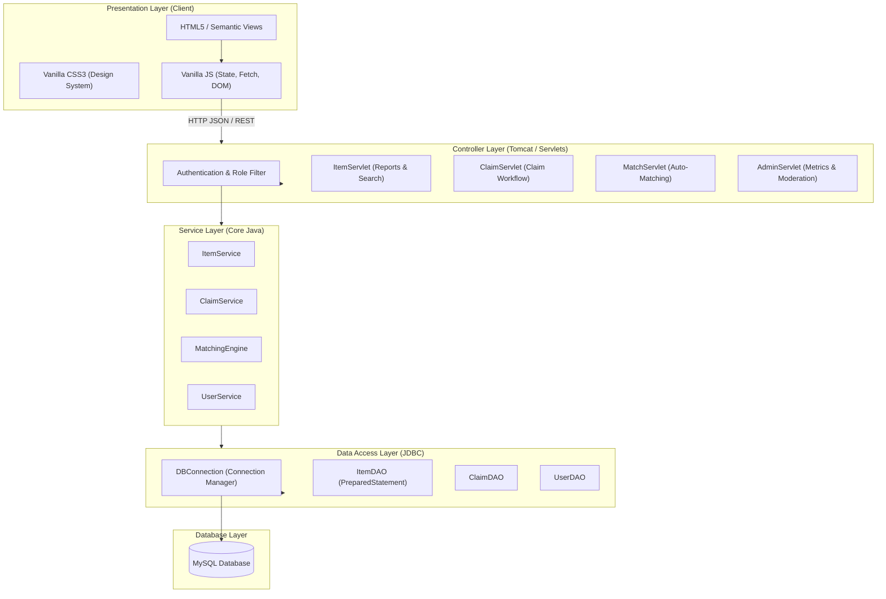
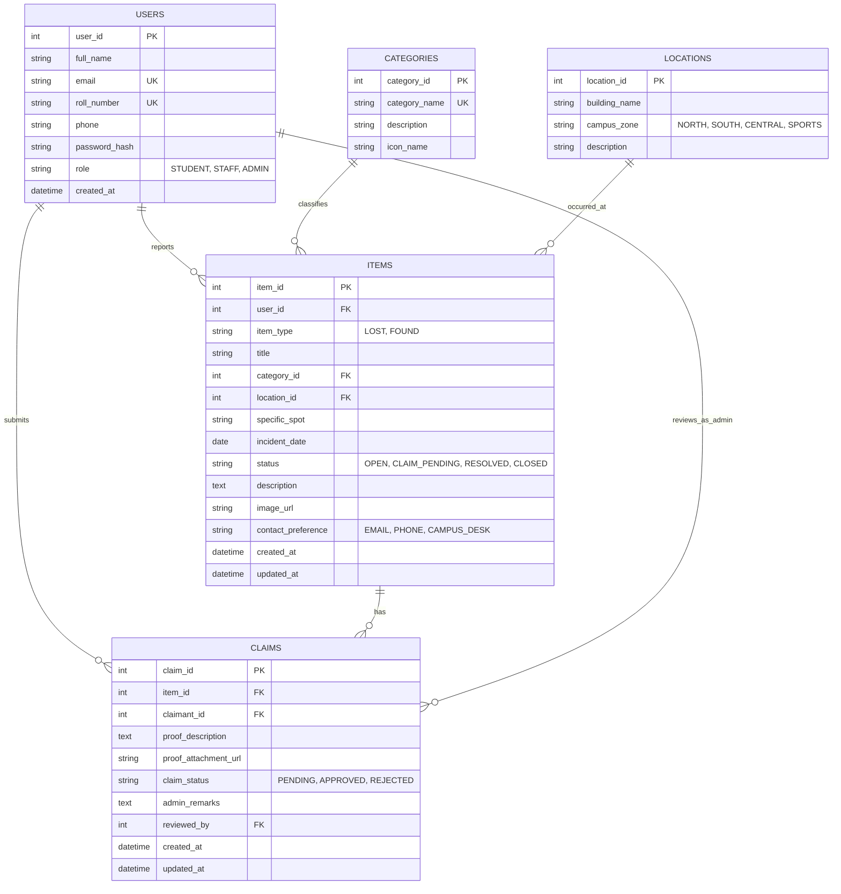

# Campus Lost & Found System — Architecture & Implementation Plan

## 1. Executive Summary & Missing Decisions Analysis

The **Campus Lost & Found System** is a centralized web platform designed for university students, faculty, and administrative staff to report, track, match, and recover lost belongings. The system eliminates manual bulletin board notices and chaotic social media posts with a structured, verifiable recovery workflow.

### Analysis of Key Architectural Decisions & Clarifications

| Decision Point | Proposed Strategy | Rationale & Student Learning Fit |
| :--- | :--- | :--- |
| **Project Build Tool** | **Maven Webapp (`pom.xml`)** | Keeps dependencies (Servlet API, MySQL Connector, Jackson/Gson) clean, reproducible, and standard without manual JAR copying. |
| **Client-Server Communication** | **Vanilla JS `fetch()` + JSON Servlets** | Provides a modern, responsive single-page feel (no jarring full-page reloads), adhering strictly to the "HTML + CSS + Vanilla JS" frontend and "Java Servlets" backend. |
| **Authentication & Authorization** | **Session-based Auth (`HttpSession`)** | Standard Java Servlet session handling. Roles: `STUDENT`, `STAFF`, and `ADMIN`. Protects claims and administrative actions. |
| **Matching Algorithm** | **Multi-factor Scoring Engine** | Matches `LOST` reports against `FOUND` reports using: (1) Category match, (2) Location proximity, (3) Date range (±7 days), and (4) Keyword token overlap. |
| **Claim Verification Workflow** | **Two-Tier Verification** | Claimant submits specific proof of ownership (identifying mark, serial #, lock screen description). Campus Admin or the finder validates before release. |
| **Media Handling** | **Optional Image Upload with Local Storage** | Stored in an upload directory with strict MIME validation, file size limits (<= 2MB), and random UUID filenames. |

---

## 2. Application Architecture & Project Structure

The project follows a standard **3-Tier Layered Architecture** suitable for educational clarity and industrial best practices.



### Proposed Directory Layout

```
campus-lost-and-found/
│
├── pom.xml                               # Maven build & dependency configuration
│
├── src/
│   └── main/
│       ├── java/
│       │   └── com/campus/lostfound/
│       │       ├── config/
│       │       │   ├── DBConnection.java     # JDBC connection factory
│       │       │   └── AppConfig.java        # Constants & upload paths
│       │       ├── controller/               # Java Servlets
│       │       │   ├── AuthServlet.java      # Login, Register, Logout, Profile
│       │       │   ├── ItemServlet.java      # CRUD for Lost/Found reports
│       │       │   ├── SearchServlet.java    # Query filters & autocomplete
│       │       │   ├── MatchServlet.java     # Matching suggestions endpoint
│       │       │   ├── ClaimServlet.java     # Claim submission & approvals
│       │       │   └── AdminServlet.java     # Stats & administration
│       │       ├── dao/                      # Direct JDBC Data Access Objects
│       │       │   ├── UserDAO.java
│       │       │   ├── ItemDAO.java
│       │       │   ├── ClaimDAO.java
│       │       │   └── CategoryDAO.java
│       │       ├── model/                    # Plain Java Beans (POJOs)
│       │       │   ├── User.java
│       │       │   ├── Item.java
│       │       │   ├── Claim.java
│       │       │   ├── Category.java
│       │       │   ├── Location.java
│       │       │   └── MatchResult.java
│       │       ├── service/                  # Business logic & algorithms
│       │       │   ├── ItemService.java
│       │       │   ├── ClaimService.java
│       │       │   ├── MatchingEngine.java
│       │       │   └── AuthService.java
│       │       ├── filter/                   # Security & CORS Filters
│       │       │   ├── AuthFilter.java
│       │       │   └── EncodingFilter.java
│       │       └── util/                     # Helper utilities
│       │           ├── PasswordUtil.java     # SHA-256 / BCrypt hashing
│       │           ├── JsonUtil.java         # JSON parsing helper
│       │           └── ValidationUtil.java   # Input sanitization
│       │
│       ├── resources/
│       │   ├── db/
│       │   │   ├── schema.sql                # DDL schema definitions
│       │   │   └── seed.sql                  # Initial categories & sample data
│       │   └── db.properties                 # MySQL credentials & URL
│       │
│       └── webapp/                           # Client-side assets
│           ├── index.html                    # Homepage (Hero, Stats, Recent items)
│           ├── browse.html                   # Search & Filter items catalog
│           ├── report.html                   # Report Lost / Found item form
│           ├── item-details.html             # Item page, matching suggestions & claim modal
│           ├── my-items.html                 # User personal dashboard (My posts & claims)
│           ├── admin.html                    # Admin portal (review reports & claims)
│           ├── login.html                    # Student/Staff authentication
│           │
│           ├── css/
│           │   ├── variables.css             # Colors, typography, spacing tokens
│           │   ├── base.css                  # Reset & baseline styles
│           │   ├── layout.css                # Header, footer, grid, container
│           │   ├── components.css            # Buttons, cards, badges, modal, forms
│           │   └── pages.css                 # Page-specific views & dashboards
│           │
│           ├── js/
│           │   ├── api.js                    # Fetch wrapper for Servlet endpoints
│           │   ├── auth.js                   # Session check & login handling
│           │   ├── browse.js                 # Dynamic search, filter & pagination
│           │   ├── report.js                 # Report validation & form submission
│           │   ├── item-details.js           # Details view, match list & claim submission
│           │   ├── admin.js                  # Admin metrics & claim approval actions
│           │   └── main.js                   # Navigation & UI interactions
│           │
│           └── assets/
│               ├── icons/                    # Clean SVG icons
│               └── images/                   # Static illustrations & defaults
```

---

## 3. Database Schema & Relational Design

The database is normalized to 3NF, enforcing foreign key constraints and strategic indexing for fast searches.



### Table Definitions & Constraints

1. **`users`**:
   - `user_id` (INT AUTO_INCREMENT PK)
   - `email` (VARCHAR(120) UNIQUE NOT NULL)
   - `roll_number` (VARCHAR(30) UNIQUE NOT NULL)
   - `password_hash` (VARCHAR(255) NOT NULL)
   - `role` (ENUM('STUDENT', 'STAFF', 'ADMIN') DEFAULT 'STUDENT')
2. **`categories`**:
   - Pre-seeded campus items: Electronics (laptops/phones), Accessories (earphones/chargers), Documents (ID cards/notebooks), Valuables (wallets/keys), Clothing/Bottles.
3. **`locations`**:
   - Pre-seeded campus hubs: Central Library, Computer Lab A/B, Main Cafeteria, Sports Complex, Engineering Block, Auditorium.
4. **`items`**:
   - Indexed on `(item_type, status, category_id, incident_date)` for instantaneous filtering.
   - Text search index on `(title, description)`.
5. **`claims`**:
   - Constrained to prevent duplicate open claims on the same item by the same claimant (`UNIQUE(item_id, claimant_id, claim_status)`).

---

## 4. Main Pages & User Workflows

### Core User Journeys

```mermaid
sequenceDiagram
    autonumber
    actor Student as Student (Finder / Loser)
    actor Admin as Campus Admin / Security
    participant Web as Web UI (Vanilla JS)
    participant Servlet as Java Servlets
    participant Service as Business Service
    participant DAO as JDBC DAO
    participant DB as MySQL DB

    Note over Student, DB: Workflow 1: Report Lost / Found Item
    Student->>Web: Fill Report Form (Category, Date, Spot, Desc)
    Web->>Servlet: POST /api/items (JSON payload)
    Servlet->>Service: validateAndSaveItem(ItemDTO)
    Service->>DAO: insertItem(item)
    DAO->>DB: PreparedStatement.executeUpdate()
    Service->>Service: triggerMatchingEngine(newItem)
    Service-->>Servlet: Created Item + Suggested Matches List
    Servlet-->>Web: 201 Created (display confirmation + matches)

    Note over Student, DB: Workflow 2: Claiming a Found Item
    Student->>Web: Click "Claim This Item" on found item detail
    Web->>Servlet: POST /api/claims (proof text, identifying marks)
    Servlet->>Service: submitClaim(claimDTO)
    Service->>DAO: insertClaim(), updateItemStatus('CLAIM_PENDING')
    DAO->>DB: Atomic Transaction (commit)
    Servlet-->>Web: 200 OK (Claim Submitted)

    Note over Admin, DB: Workflow 3: Admin Review & Item Resolution
    Admin->>Web: Inspect Pending Claims in Admin Portal
    Admin->>Web: Verify Student Roll No & Proof details -> Click "Approve"
    Web->>Servlet: POST /api/admin/claims/review (claimId, status='APPROVED')
    Servlet->>Service: processClaimReview()
    Service->>DAO: updateClaimStatus('APPROVED'), updateItemStatus('RESOLVED')
    DAO->>DB: Commit changes
    Servlet-->>Web: Item marked RESOLVED; handover instructions displayed
```

### Page Breakdown

1. **Homepage (`index.html`)**:
   - Clean white hero header with immediate dual call-to-action: **"I Lost Something"** & **"I Found Something"**.
   - Search box with campus building and category quick-filters.
   - Live campus metrics: Total Items Reported, Successfully Reunited, Active Lost Cases.
   - Recent lost & found cards with timestamp badges.
2. **Catalog & Search (`browse.html`)**:
   - Left sidebar with faceted filters (Status, Type: Lost/Found, Category, Location, Date range).
   - Real-time search with debounce.
   - Responsive card grid displaying item title, category badge, location, date, and current status.
3. **Item Reporting (`report.html`)**:
   - Toggle switch for "Lost an Item" vs "Found an Item".
   - Structured inputs: Title, Category dropdown, Date lost/found, Campus building, Specific room/area, Description, Contact details.
   - Immediate feedback preview card on the right.
4. **Item Details & Match Suggestions (`item-details.html`)**:
   - High-contrast details card.
   - **Smart Matching Box**: Lists top potential matching reports with match percentage score.
   - Action button: **"Claim Item"** (triggers claim modal with ownership verification questions).
5. **Student Activity Portal (`my-items.html`)**:
   - Tabbed view: "My Reported Items" (with edit/mark resolved options) and "My Active Claims" (with status tracker: Pending Verification, Approved, Ready for Pickup).
6. **Admin Management Console (`admin.html`)**:
   - Security desk / office view.
   - Filter items needing moderation.
   - Claim dispute resolution desk with claimant contact information and submitted ownership proof.

---

## 5. Development Phases Breakdown

### Phase 1 — UI Design & Frontend Architecture
- Establish clean, white-based design system in `variables.css` & `base.css`:
  - Pure white `#FFFFFF` & cool tinted background `#F8FAFC`.
  - Dark navy typography `#0F172A` & secondary slate `#475569`.
  - Restrained accent blues `#2563EB` and `#1D4ED8` for interactive elements.
  - Semantic status indicators: Amber for Pending, Emerald for Resolved, Sky for Open.
- Build responsive templates for all 6 pages using accessible semantic HTML5.
- Create modular UI components: interactive modals, notification toast system, loading skeletons, and empty states.

### Phase 2 — Database Schema & Data Modeling
- Write `schema.sql` with complete constraints, foreign keys, and indexes.
- Write `seed.sql` with university categories, campus buildings, and realistic demo data.
- Verify foreign key cascades (`ON DELETE RESTRICT`, `ON UPDATE CASCADE`) to maintain audit trails.

### Phase 3 — Backend Java Classes & Business Logic
- Create clean Java POJOs matching database entities.
- Implement the `MatchingEngine` scoring algorithm (Category equality = 40pts, Date within ±5 days = 30pts, Location equality = 20pts, Keyword overlap = 10pts).
- Develop Servlets with clean REST-style routing (`GET`, `POST`, `PUT`).
- Implement request parameter extraction, validation, and JSON conversion.

### Phase 4 — JDBC Connection & Data Access Layer
- Create `DBConnection` utility with configurable properties loader and connection pooling (using HikariCP or a lightweight custom pool for pure JDBC).
- Implement `UserDAO`, `ItemDAO`, and `ClaimDAO` using strictly `PreparedStatement` and `try-with-resources`.
- Implement transactional operations for claims (atomic updates across `claims` and `items`).

### Phase 5 — Frontend Integration
- Connect all HTML forms to Java Servlets using Vanilla JS `fetch()`.
- Add interactive state handling (live search debounce, dynamic DOM updates, toast notifications).
- Connect the Claim modal workflow and dynamic matching suggestions widget.

### Phase 6 — Testing & Quality Assurance
- Test database transactions under concurrent requests.
- Validate security against SQL injection, XSS, and unauthorized claim modifications.
- Test responsive layouts across mobile (375px), tablet (768px), and desktop (1280px+).
- Run full end-to-end user journeys (Report Lost -> Report Found -> Auto Match -> Submit Claim -> Admin Approval -> Case Resolved).

---

## 6. Technical Risks & Security Considerations

| Risk Category | Vulnerability | Mitigation Strategy |
| :--- | :--- | :--- |
| **Database Security** | SQL Injection | **Strict parameterization**: Use `PreparedStatement` exclusively. No dynamic SQL string concatenation anywhere in the codebase. |
| **Web Security** | Cross-Site Scripting (XSS) | **Output encoding**: All user descriptions and titles are sanitized and inserted into the DOM via `textContent` or escaped templates, never raw `innerHTML`. |
| **Access Control** | Broken Object Level Authorization (BOLA) | Validating `user_id` from the secure server session against the item/claim owner before permitting updates or viewing sensitive claims. |
| **Resource Management**| Connection Leaks | Using Java 7+ **`try-with-resources`** blocks for every `Connection`, `PreparedStatement`, and `ResultSet` to guarantee closure even upon exceptions. |
| **Fraudulent Claims** | False Claim Abuse | Found items do not publicly expose private identifying marks (e.g. unique scratches, serial numbers). Claimants must describe these marks independently. |

---

## 7. Next Step & Execution Order

Upon your review and approval:
1. We will begin **Phase 1 (Design & Page Structure)**: establishing the design system CSS and page wireframes/layouts.
2. We will advance sequentially through each phase, asking for your sign-off before proceeding.
